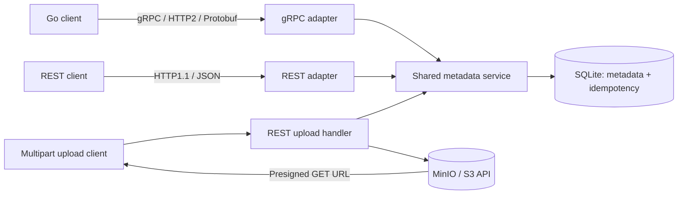

# SIS #2 — Image hosting protocol implementation

Go implementation for Backend for High-Loaded Systems. **gRPC/Protobuf over
HTTP/2** is compared with **REST/JSON over HTTP/1.1**, using the same service,
SQLite database, timeout policy, and retry policy. Go was approved in place of
Java. This is a runnable implementation of part of the SIS #1 architecture;
it does not claim to serve 100M DAU on a laptop.

Start with [the defense guide](docs/DEFENSE.md), then follow
[the code walkthrough](docs/WALKTHROUGH.md). [Decisions and alternatives](docs/DECISIONS.md)
explain why this implementation is appropriate for the assignment.

## Run and test

Requires Go 1.24+; Docker is needed only for MinIO. Generated Protobuf files are
included, so `protoc` is unnecessary unless you change the contract.

```sh
go test -race ./...
go vet ./...
go run ./cmd/server
```

Default listeners: gRPC `localhost:9090`, REST `localhost:8080`.
Metadata persists in `sis2.db`; bytes use `./objects` until MinIO is configured.
Stop the server with Ctrl-C. Both listeners shut down gracefully.

### Real MinIO storage

```sh
docker compose up -d --build
curl --fail http://localhost:9000/minio/health/live
# Wait until the health request succeeds, then run:
set -a
. ./.env.example
set +a
go run ./cmd/server
```

The demo credentials are `minioadmin` / `minioadmin`. The MinIO console is
`http://localhost:9001`. `MINIO_CREATE_BUCKET=true` creates the `images` bucket
on server startup. With it disabled, provision the bucket beforehand.
`MINIO_REGION` defaults to `us-east-1`; set it if your MinIO uses another region.
An explicit region lets presigned URLs be generated without contacting MinIO.

Compose builds the pinned official MinIO source release. Published images
could not be pulled during verification, so this setup does not depend on them.
The first build downloads Go dependencies; subsequent builds use Docker's cache.
The source-build approach follows the [official release instructions](https://github.com/minio/minio/releases/tag/RELEASE.2025-10-15T17-29-55Z).

Run the optional **real MinIO** integration test:

```sh
SIS2_TEST_MINIO_ENDPOINT=127.0.0.1:9000 go test -race ./internal/transport -run TestMultipartUpload -v
```

It uploads a PNG, repeats the upload with the same key, rejects a conflicting
caption, and checks downloaded bytes through a presigned URL. Without the env
variable the MinIO subtest is skipped; the local storage subtest still runs.

## Implemented scope and SIS #1 mapping



| SIS #1 component | Implemented here | Limit |
|---|---|---|
| Image metadata service | Create, complete upload, get, update caption, soft delete, cursor list | Reduced image model; no tags or variants |
| Interaction service | Users, comments, likes, share tokens and counters | Same process/database for a small project |
| DynamoDB / Cassandra | Real SQLite transactions and persistent rows | One local database connection |
| S3 | Real MinIO object upload and presigned GET URL | One local MinIO instance, no production durability claim |
| Async image worker | Synchronous `PENDING -> READY` completion | Resizing, verification of supplied object keys, `PROCESSING` and `FAILED` are mocked/omitted |
| API gateway, CDN, Redis, auth | Omitted | No caching, access control, or geographic distribution |

The multipart endpoint proxies bytes through this service for a simple demo.
In SIS #1 the client uploads directly to S3 using a presigned **PUT** URL.
The implemented presigned **GET** URL is for downloads. Metadata benchmarks
exclude image-byte transfers and MinIO calls.

`CreateImage` makes `PENDING` metadata. Completion requires a nonempty object
key and changes it to `READY`; completion of `READY` is safe to repeat. Lists
return only `READY` images. Delete marks `DELETED`, hides it from reads/lists,
and prevents completion or updates from reviving it. Raw object bytes remain
until a future cleanup process removes them. `GetImage` also exposes pending
metadata; owner-only visibility is not enforced because auth is omitted.

Share-link creation stores a random token and expiry. Resolving those tokens
into an access-controlled image URL is not implemented.

## Protocol choice

gRPC gives a typed, generated contract, binary Protobuf messages, status codes,
and deadline propagation. HTTP/2 multiplexes calls over a connection and compresses
headers. Those features fit frequent internal metadata calls. They do **not**
guarantee lower latency for every workload.

REST/JSON is easy to inspect and works directly in browsers. In the full SIS #1
system it remains a reasonable public API, while gRPC connects gateway and
services. WebSocket is useful for server push; for these request/response methods
we would have to design our own correlation, errors, deadlines and retry rules.
Raw HTTP/2 with JSON retains JSON payloads and requires separate API tooling.

## Idempotency: a retry must not duplicate a write

A key identifies **one logical operation**. Reuse it for retry attempts; generate
a new key for a new action. Send it as `Idempotency-Key` in REST, `idempotency-key`
in gRPC metadata, or `idempotency_key` in the request. Conflicting header/body keys
are rejected. Keys must be at most 200 bytes and should be unique across operations.

| Operation | Behavior |
|---|---|
| Create image / update caption | Key required |
| Create user / comment / share link | Key optional, but client retries only when provided |
| Like image | Unique `(image_id, user_id)` makes the effect naturally idempotent |
| Complete / delete | Repeating the action has no additional effect |
| Get / list | Read-only; safe to retry |

The server calculates SHA-256 of the method and deterministic Protobuf request.
The request includes the actor/owner fields. The demo's post-commit delay is
excluded because it is not business data. In one SQL transaction it:

1. Checks the key and its 24-hour expiry.
2. Returns the saved response for the same fingerprint, or rejects a different
   fingerprint with `INVALID_ARGUMENT` / HTTP 400.
3. Performs the business change and saves its serialized response.
4. Commits both together, then sends the response.

Concurrent duplicates wait for the database connection, then replay the result.
Uncommitted work is rolled back on failure; no separate `IN_PROGRESS` lease is
needed for this single-database design. The server prunes expired records hourly
and also checks expiry on access. **After 24 hours, the same key may create a new
write.** This is a bounded replay guarantee, not universal exactly-once execution.

If the commit succeeds but the response is lost, the client cannot infer success
from the timeout. Retrying the **same key and request** finds the saved result and
returns the same image ID without another insert. Restarting the server preserves
that result because both records are durable. Only successful responses are cached.
Replay returns the original response snapshot, which can differ from the current
image after later updates.

Object storage and SQL are not one transaction. Uploads use deterministic keys
containing the content hash, so conflicting content cannot overwrite the first
object. Failure between the object upload and SQL commit can leave an orphan;
a production system needs reconciliation/cleanup.
A validated replay skips the object upload; conflicting saved requests are rejected
before storage writes. Concurrent first attempts may still upload the same
deterministic object key before SQL deduplication. Interrupted object downloads
abort the HTTP stream so clients detect incomplete transfers.

## Timeouts and retries

The shared client accepts a per-attempt timeout and maximum attempts. It creates
an overall deadline even if the caller forgot one. A caller's shorter deadline
always wins. With four attempts, backoff caps are 20, 40 and 80 ms:

```text
Create example: 4 × 300 ms + 20 + 40 + 80 ms = 1340 ms overall budget
Get example:    4 × 100 ms + 20 + 40 + 80 ms =  540 ms overall budget
```

These are maximum waiting budgets, not measured latency or a claim that p99
meets the SIS #1 target under production load. The benchmark defaults to the
same 300 ms timeout for both protocols; `-timeout 100ms` changes it.

Each retry sleeps uniformly in `[0, min(20ms × 2^attempt, 200ms)]` (full jitter).
Only `UNAVAILABLE`, `ABORTED`, `RESOURCE_EXHAUSTED`, and per-attempt
`DEADLINE_EXCEEDED` are retryable, and only while the operation's overall deadline
allows it. REST errors carry the corresponding code in JSON; 502/503/504 and 429
from an upstream are mapped too. Validation, missing records, conflicts and
precondition failures are not retried. Unsafe writes without keys get one attempt.

SQL calls and injected delays respect context cancellation. Cancellation before
commit can prevent a write. Cancellation **after** commit cannot undo it.
gRPC propagates the deadline; the REST client sends `X-Request-Timeout-Ms` so the
handler gets an equivalent context deadline. HTTP read/header/write/idle timeouts
also bound connection handling, but are not substitutes for handler cancellation.

The custom client wrapper keeps this policy visible and shared across protocols.
gRPC's built-in configurable retries are useful in larger clients, but enabling
both would obscure the attempt count. The benchmark disables configured gRPC
retries; gRPC can still transparently retry calls that did not reach application
execution. A fleet-wide retry token budget/circuit breaker is outside this prototype.
See the official [deadline](https://grpc.io/docs/guides/deadlines/) and
[retry](https://grpc.io/docs/guides/retry/) guides.

## REST routes and gRPC methods

| REST | gRPC |
|---|---|
| `POST /v1/users` | `CreateUser` |
| `POST /v1/images` | `CreateImage` |
| `POST /v1/images/{image_id}/complete` | `CompleteUpload` |
| `GET /v1/images/{image_id}` | `GetImage` |
| `PATCH /v1/images/{image_id}` | `UpdateImage` |
| `DELETE /v1/images/{image_id}` | `DeleteImage` |
| `GET /v1/users/{owner_id}/images?limit=20&cursor=...` | `ListUserImages` |
| `POST /v1/images/{image_id}/comments` | `CreateComment` |
| `POST /v1/images/{image_id}/likes` | `LikeImage` |
| `POST /v1/images/{image_id}/share-links` | `CreateShareLink` |
| `POST /v1/images/upload` (multipart) | REST-only byte upload |
| `GET /v1/objects/{key...}` | REST-only byte proxy |

JSON uses Protobuf JSON mapping with snake_case names. Its `int64` counters are
JSON strings, and default fields may be omitted. This is one JSON implementation,
not a measurement of every possible REST stack.

Quick reproducible upload demo (server required):

```sh
./scripts/demo-upload.sh
./scripts/demo-upload.sh                  # Same key: same image
./scripts/demo-upload.sh demo-upload-v2-1 changed-caption  # Conflicting key: HTTP 400
```

Example real upload (replace the image path):

```sh
curl --fail-with-body http://localhost:8080/v1/images/upload \
  -H 'Idempotency-Key: demo-upload-1' \
  -F 'owner_id=demo-owner' -F 'caption=My first image' \
  -F 'image=@/path/to/photo.png'
```

It returns `image`, `object_key`, and `object_url`. Repeat unchanged with the same
key to obtain the same image. Use a new key for a different action. JPEG, PNG,
and WebP signatures are accepted; maximum image size is 16 MiB. Full image
integrity/security scanning is not implemented.

## Measurements

```sh
make bench
```

This starts its own server on loopback ports **19090/18080**, using a separate
temporary database. It verifies its own child process using a readiness PID file
written after all ports bind, and stops if startup fails. It does not modify `sis2.db`. Server and client are separate
processes with `GOMAXPROCS=2`. Each normal configuration runs three times with
100 warmup and 2,000 measured calls. The report takes the median of each metric
across runs, not a pooled percentile. Each owner has 40 seeded `READY` images;
a list returns 20. Creates always use fresh keys, never an accidental replay.
Workloads are get, list, create, and a 90% get / 5% list / 5% create mix; captions
are 80 characters (typical) and 1,000 characters (edge). Concurrency is 1 or 16.

[Full measurements and environment](results/REPORT.md),
[raw CSV](results/raw.csv), [median CSV](results/summary.csv).

<!-- MEASURED_TABLE_START -->

Measured on the machine in `results/environment.txt`; typical 80-character captions.

| Workload | Clients | Protocol | p50 ms | p99 ms | RPS | Response body B |
|---|---:|---|---:|---:|---:|---:|
| get | 1 | grpc | 0.059 | 0.131 | 16353.500 | 209.000 |
| get | 1 | rest | 0.054 | 0.109 | 17867.100 | 295.000 |
| list | 1 | grpc | 0.094 | 0.198 | 10166.800 | 4304.000 |
| list | 1 | rest | 0.122 | 0.227 | 7726.900 | 5890.000 |
| create | 1 | grpc | 0.117 | 0.278 | 7137.000 | 191.000 |
| create | 1 | rest | 0.114 | 0.262 | 7389.600 | 262.000 |
| get | 16 | grpc | 0.209 | 0.930 | 61838.800 | 209.000 |
| get | 16 | rest | 0.210 | 1.136 | 56219.500 | 295.000 |
| list | 16 | grpc | 0.604 | 3.300 | 19352.200 | 4304.000 |
| list | 16 | rest | 0.783 | 4.201 | 15078.900 | 5890.000 |
| mix | 16 | grpc | 0.250 | 1.645 | 44687.200 | 412.900 |
| mix | 16 | rest | 0.273 | 1.928 | 38226.500 | 573.100 |

In this run, single-client Get p50 was **0.059 ms** for gRPC and **0.054 ms** for REST.
The 20-image list p50 was **0.094 ms** versus **0.122 ms**; the Protobuf response
body was about **26.9% smaller**. At 16 clients the mixed workload completed
**44,687 RPS** with gRPC versus **38,226 RPS** with REST.
These are observations, not universal protocol rankings. Single-client Create was close;
for 1,000-character captions the list-body saving shrank to **6.4%**,
consistent with caption text dominating both encodings.

The grpc response-loss trial completed **100 logical calls, 200 attempts, 100 retries, 0 errors**; p50 was **42.364 ms**.
The rest response-loss trial completed **100 logical calls, 200 attempts, 100 retries, 0 errors**; p50 was **42.001 ms**.
The deadline and backoff dominate recovery latency; idempotency protects the write's correctness.


<!-- MEASURED_TABLE_END -->

`body_*_bytes` counts actual JSON bodies or Protobuf message bytes. A REST GET
has zero request-body bytes because its parameters are in the URL.
`wire_*_bytes_per_op` wraps client `net.Conn` reads/writes, including HTTP headers,
HTTP/2 frames, gRPC framing/trailers and retry traffic. It excludes TCP/IP packet
headers, retransmissions, and TLS (all tests use cleartext with no compression).
Warmup traffic is excluded; tiny asynchronous HTTP/2 control frames near the
measurement boundary can add noise. Byte values are averages per logical call,
including retries; payload body counters include any received REST error bodies.
These are stream-byte counts, not packet-capture totals.

Latency measures the complete logical call, including failed attempts/backoff,
and includes both successes and failures; errors are reported separately. RPS is
completed logical calls per second, not network attempts. The response-loss trial
has one run of 100 calls: first attempt commits, then its response is delayed
past 30 ms; the retry replays immediately. This demonstrates recovery cost.

Limitations: small localhost dataset; short runs; shared laptop; closed-loop load
waits for responses, so it can hide queueing during stalls (**coordinated omission**).
An open-loop generator would keep scheduled arrivals and expose that queueing.
REST over HTTP/2, TLS, compression, independent arrival-rate tests, production
networks and large datasets are not measured, so this comparison does not isolate
HTTP/2 from Protobuf or establish production capacity. TLS costs would need to be
measured; they cannot simply be assumed equal across connection patterns.

## Fault demonstrations

```sh
# Start separately from any normal server using the same ports:
go run ./cmd/server -db demo-fault.db -fail-after 1 -fault-method CreateImage
```

The first `CreateImage` commits, but returns an injected `UNAVAILABLE` / 503.
A keyed retry gets the saved result. `-fail-before N` rejects the first N matching
calls without executing them. `-delay 200ms -fault-method GetImage` adds a
cancellable delay before execution; a 100 ms attempt should time out. Fault
counters are shared by both listeners, and are reset by restarting the server.
The `response_delay_ms` request field is an additional **demo-only** post-commit
fault; remove/disable fault controls before exposing a production API.

```sh
# Normal server required; deliberately lose every first response by timeout:
go run ./cmd/benchmark -protocol grpc -workload response-loss -timeout 30ms -n 100
# Same scenario using REST:
go run ./cmd/benchmark -protocol rest -workload response-loss -timeout 30ms -n 100
```

## Checks and compatibility

`go test -race ./...` covers persistence/restart, 50 concurrent duplicates,
conflicting keys, key expiry, transaction rollback, response loss, context
cancellation, retry exhaustion, unsafe-write retry prevention, pagination,
state transitions, social counters, upload replay and local object integrity.
`go vet ./...` checks suspicious Go usage.

`make proto` regenerates the contract with pinned Go plugins; it requires `protoc`
on PATH or `.tools/protoc/bin/protoc`. Regenerate instead of editing `.pb.go`.
The former handwritten JSON codec/types were replaced by generated bindings.
Existing SQLite data receives additive column/index migrations. The old images
`idempotency_key` column is retained for schema compatibility; the new dedicated
table owns replay semantics for writes made with this implementation. Do not
assume old prototype keys were backfilled into that table.

## Optional load testing and monitoring

Prometheus, Grafana and a k6 REST/gRPC workload are available as an additional
demo. Start the API with `go run ./cmd/server -metrics-addr :9095`, then run
`make monitoring-up`, followed by `make load-rest` or `make load-grpc`.
[Grafana](http://localhost:3000/d/sis2-service) uses `admin` / `sis2admin`.
See [the observability guide](docs/OBSERVABILITY.md) for the data flow, dashboard,
thresholds, commands, and why auth/Redis/durable processing remain outside scope.
Metrics are disabled by default so `make bench` keeps its controlled setup.
